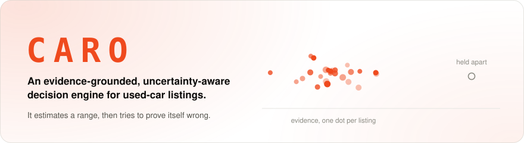
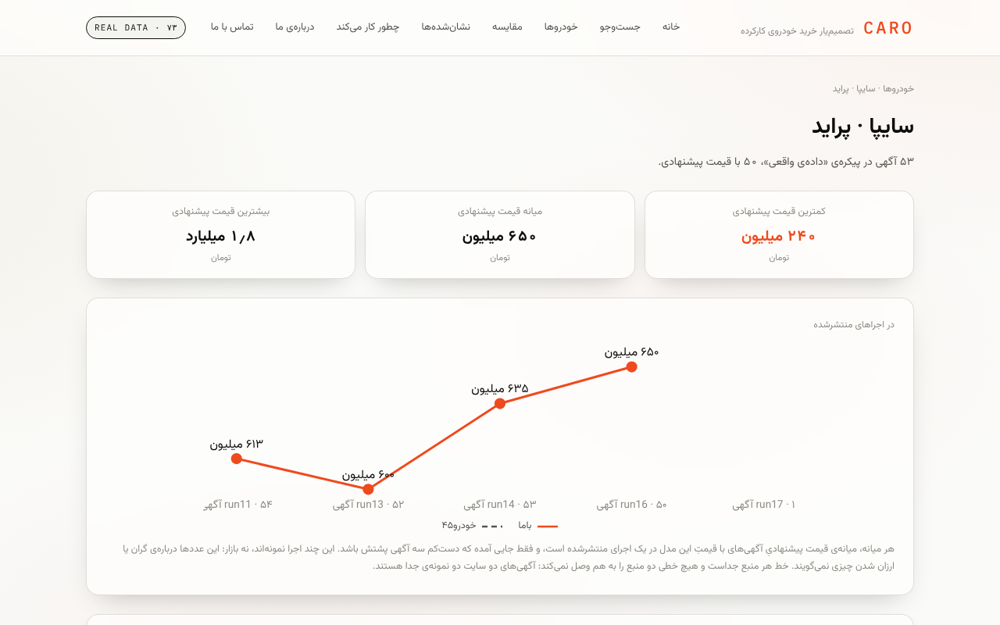
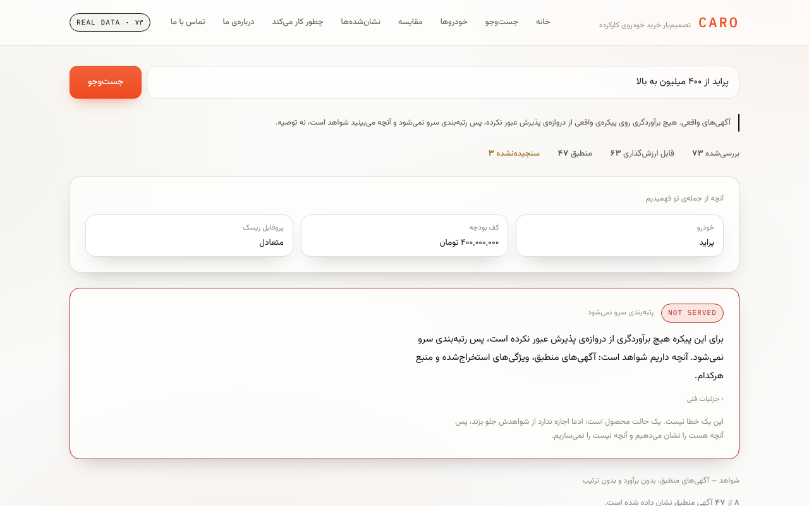
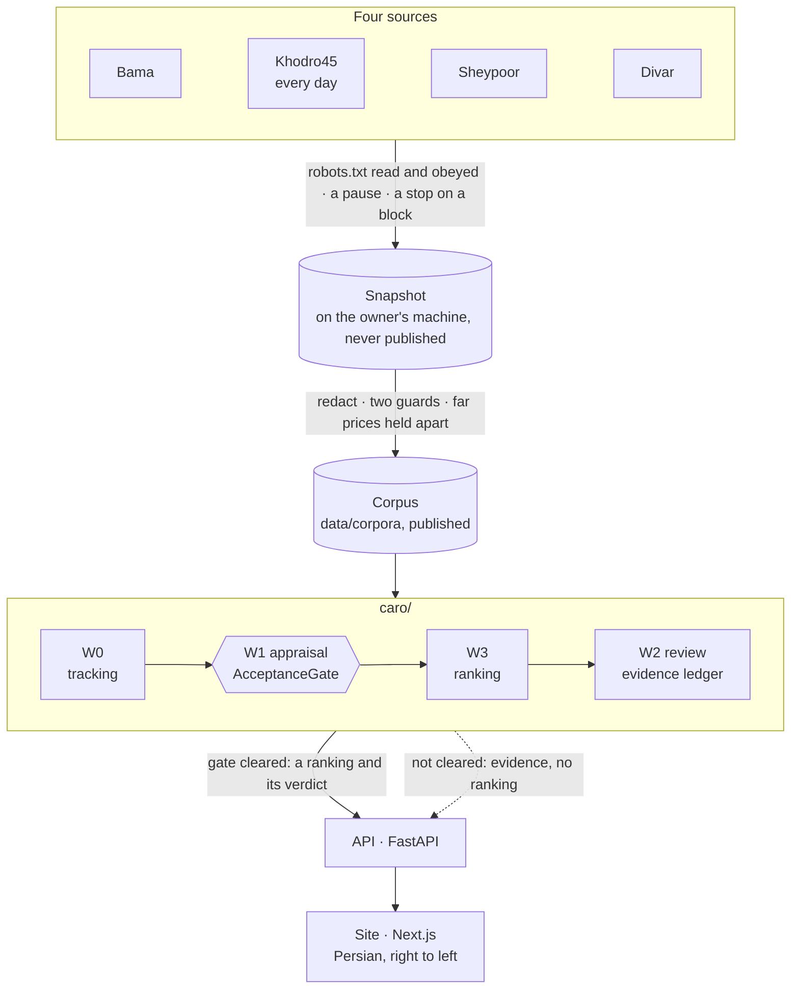
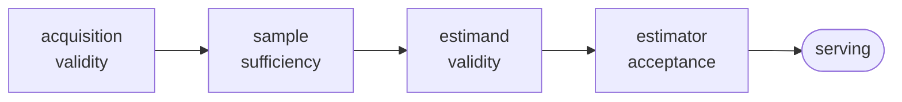
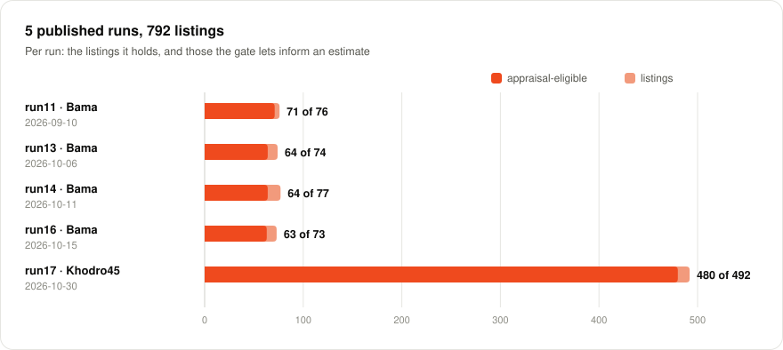
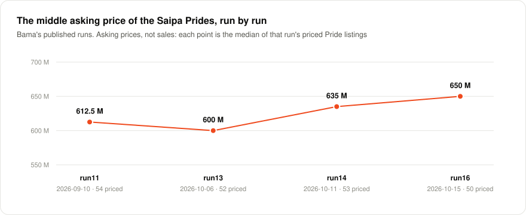
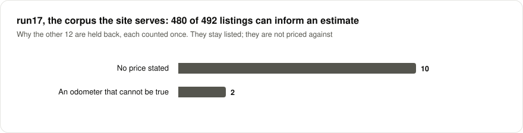

<div align="center">

<picture>
  <source media="(prefers-color-scheme: dark)" srcset="docs/readme/hero-dark.svg">
  
</picture>

[](https://github.com/sahandmusanezhad/caro/actions/workflows/ci.yml)
[](https://caro-rho.vercel.app)
[](#run-it)
[](webapp/README.md)
[](LICENSE)

**[Live site](https://caro-rho.vercel.app)** · **[How it works](#how-it-works)** · **[Where it stands](#where-it-stands)** · **[The data](#the-data)** · **[Run it](#run-it)** · **[Decisions](docs/DECISIONS.md)** · **[Roadmap](docs/ROADMAP.md)**

</div>

---

**It is live at https://caro-rho.vercel.app.** The site serves 492 real
Khodro45 listings collected on 2026-10-30 (`data/corpora/run17.json`). Ask it in
Persian for a car, and it shows the listings that meet the request, what it
read from the request and what it did not. It does not rank them: no
estimator has cleared the acceptance gate on a real corpus (D43), and a
ranking that has not cleared it is not served. Every screen says which
corpus it is reading.

<table>
<tr>
<td width="50%"><a href="docs/readme/site-model-dark.png"><picture><source media="(prefers-color-scheme: dark)" srcset="docs/readme/site-model-dark.png"></picture></a></td>
<td width="50%"><a href="docs/readme/site-search-dark.png"><picture><source media="(prefers-color-scheme: dark)" srcset="docs/readme/site-search-dark.png"></picture></a></td>
</tr>
<tr>
<td align="center"><sub><b>A model's page.</b> Asking prices, counted: the smallest, the middle and the largest, and the middle of every published run, one line per source.</sub></td>
<td align="center"><sub><b>A search.</b> «پژو ۲۰۶ زیر ۱.۵ میلیارد»: what was read, the notice that no ranking is served, and the 21 listings that meet it.</sub></td>
</tr>
</table>

<sub>The site as built from this commit, serving run17, captured locally on 2026-11-02.</sub>

---

## Why it exists

Torob works because one product has many sellers: one SKU, twelve prices,
pick the cheapest trustworthy one. Matching is trivial; the value is the
comparison.

**In used cars that premise collapses.** No two cars are the same object —
mileage, paint history, documents, region, and seller honesty all differ. So
a naive "Torob for cars" is a marketplace with a sort button, and sorting by
price can harm the buyer, because the cheapest listing can systematically
favour damaged cars.

CARO's answer is not a cheaper number. It is a **defensible** one — an
estimate that carries its own evidence, its own uncertainty, and a record of
the checks that tried to invalidate it. And where the evidence is not good
enough to speak, it does not speak, and says why.

> **The adversarial reviewer is deterministic.** A reviewer written as a
> language-model prompt can be talked out of a finding, can invent one that
> is not there, and answers differently on a rerun. A reviewer written as
> checks over an evidence packet can do none of those. So the whole system
> runs offline, with no API key; a language model is optional and enters at
> exactly one point — rendering a finished verdict as prose. `Verdict` is a
> frozen dataclass, and a test asserts that changing it raises. **A language
> model may explain a decision. It may not make or overturn one.**

---

## How it works



| Layer | Module | What it guarantees |
|---|---|---|
| **Ingest** | `caro/ingest/` | A blocked source halts collection — no rotation, no retry-harder. A failed page is ignorance about that page, not absence of its listings. A raw seller identifier never reaches disk. robots.txt is read before the first request and asked before every one after (RFC 9309, D73). |
| **Promotion** | `scripts/promote_corpus.py` | Seller-authored text is redacted, two guards run on the exact bytes written, and a price far from its model's middle in its run is held apart. A corpus that fails a guard is never written to disk. |
| **W0** | `caro/tracking.py` | A failed fetch is never an absence. A disappearance is never a sale. A blocked crawl cannot corrupt the history. Reposts link on precision, never on a guess. |
| **W1** | `caro/appraisal.py` | No physical car appears on both sides of a split. Quantiles cannot cross. An unbenchmarked estimator cannot serve a number. |
| **W3** | `caro/ranking.py` | Assumptions are surfaced, never silent. What the parser leaves is listed under «نفهمیدیم» where a rule finds it. A deal-breaker is never relaxed away. Risk is priced in tomans, not normalised. |
| **W2** | `caro/agents.py` | Every user-facing claim resolves to an observation. Hard contradictions veto. Confidence is a published policy, not a fitted score. |
| **Site** | `webapp/` | The API may not be more informative than the evidence behind it (D50). A REAL failure never becomes a SYNTHETIC success (D49). The corpus label is on every screen. |

The part that turned out to be hard is none of crawl, normalise, rank or
explain: it is knowing when the evidence is good enough to speak. So the
architecture is a chain of gates, each of which can only make a narrower
claim than the one before it:



Run 3 clears the first two. D30 stops it at the third. D34 stops it at the
fourth. A number that reaches the end has passed all of them, and a number
that does not is *absent* rather than caveated — `MarketEstimator.predict()`
raises rather than returning, and `aggregate()` refuses a model-level figure
that arrives without its sampling sensitivity. CARO reports uncertainty about
prices, and **uncertainty about its own ability to assess uncertainty** —
and refuses on it. [ARCHITECTURE](docs/ARCHITECTURE.md) says which components
are deliberately *not* agents, and why.

---

## Where it stands

The brief asks for **crawl offers → normalize messy data → rank by user
intent → explain the best choice**.

| Requirement | State, 2026-11-01 |
|---|---|
| crawl offers | ⚠️ **two sources published.** Four runs of `BamaAdapter` and one of Khodro45's ([the data](#the-data)), every line of run16 and run17 read before it was published; the site serves run17. Khodro45 runs every day on the owner's machine (TEMPORAL_CONTRACT §11) and Sheypoor has run live, none of its runs published. `DivarCarAdapter` has read one saved real page (24 of 24 listings) and its live path has never run. |
| normalize messy data | ✅ **built.** Persian numerals and amount words, toman and rial, mileage, Jalali and Gregorian years, make and model aliases, trim, gearbox, fuel, colour, body condition from free text, and the province — the 31 capitals give theirs — with how each was read. |
| rank by user intent | ⚠️ **built, not served on real data.** `caro/ranking.py` reads a Persian request, filters, relaxes and scores. No estimator has cleared the gate on a real corpus, so the site shows evidence, not a ranking. On the synthetic corpus, where the gate passes, the ranking is served and measured. |
| explain the best choice | ✅ **built.** A frozen verdict, an evidence ledger, and an adversarial review that is code, not a prompt. |
| deployed | ✅ **from `main`** — one Vercel project of two services (D64, D80), following [Tecso-Dev/caro](https://github.com/Tecso-Dev/caro). |

Everything that is left until the end of the project — in order, with what
closes each item and who does it — is in [ROADMAP](docs/ROADMAP.md), in two
tracks. The evidence track is the owner's: Divar live, a larger corpus over
time, an estimator that clears the gate. The platform track is the 2026
plan, [REARCHITECTURE](docs/REARCHITECTURE.md), Sobhan's, accepted on
2026-11-02 with its review's amendments, each phase an issue in
[Tecso-Dev/caro](https://github.com/Tecso-Dev/caro/issues):

| Phase | What | State |
|---|---|---|
| 0 | foundation: the agreement for two, `caro.noxioai.com` behind Cloudflare, alerts, branch protection, a reachability probe from Iran | **closed** 2026-11-03 by the owner's choice (D99); the four steps in the owner's accounts carried to an issue of their own ([the steps](docs/PHASE0_SETUP.md)) |
| 1 | containers: one image for the API and the workers, one for the site; Compose with Postgres and nginx; staging and production | built (sahandmusanezhad/caro#18); the server's steps wait on the owner ([the steps](docs/PHASE1_SETUP.md)) |
| 2 | data: the catalog of published runs in Postgres, the seller listings on with a real SMS provider | built (sahandmusanezhad/caro#19), off until an SMS account and the server ([the steps](docs/PHASE2_SETUP.md)) |
| 3 | the queue in Postgres, the collection worker | built (sahandmusanezhad/caro#20), waiting on the owner's machine, a bucket and a bot ([the steps](docs/PHASE3_SETUP.md)) |
| 4 | the edge: a cache keyed by the corpus digest, rate limits, Turnstile, k6 | built (sahandmusanezhad/caro#21), waiting on Cloudflare's settings ([the steps](docs/PHASE4_SETUP.md)) |
| 5 | the design system and the panels, in Next.js | |
| 6 | the site in its own image, Vercel retired | |
| 7 | observability, ten times the load, D56's measurements, Kubernetes decided | |

How the work is done, and the rules every session keeps, are in
[WORKING_AGREEMENT](docs/WORKING_AGREEMENT.md).

### Try it

Four requests, asked of this commit's API on 2026-11-02, on run17:

```
دنا از ۳ میلیارد به بالا          a budget floor of 3 billion and no ceiling:
                                  17 of run17's 40 Dena listings meet it, and
                                  2 are held apart because they carry no price

دنا در مشهد                       a city is not read, so it is not used; the
                                  page lists «در مشهد» under «نفهمیدیم» and
                                  shows the 40 Dena listings

دنا زیر ۱۰۰ هزار کیلومتر          the model Dena and an odometer cap of
                                  100,000 km: 33 of the 40 meet it

کوییک در تهران                    the province is a constraint like the
                                  budget: 9 of run17's 36 Quiks are in Tehran
```

The search page's panel is «آنچه از جمله‌ی تو فهمیدیم»: the model, the
ceiling and the floor of the budget, the minimum year, the odometer cap, the
province, the use, the risk profile and the red lines. Whatever the parser
assumed is printed with it — «عدد قیمت را سقف بودجه فرض کردیم» when a lone
amount is taken for the ceiling — and what it leaves unread is listed under
«نفهمیدیم» wherever a rule finds it. A listing is a match only where every
constraint stated was checked against it; one that carries no value for a
constraint is held apart and says which (D65).

---

## The data

Every published corpus, as `data/corpora` holds it. Snapshots stay on the
owner's machine; what is published is a promoted corpus, under
[DATA_CONTRACT](docs/DATA_CONTRACT.md).

| Run | Source | Collected | Listings | Appraisal-eligible | |
|---|---|---|---|---|---|
| run11 | Bama | 2026-09-10 | 76 | 71 | |
| run13 | Bama | 2026-10-06 | 74 | 64 | |
| run14 | Bama | 2026-10-11 | 77 | 64 | |
| run16 | Bama | 2026-10-15 | 73 | 63 | served until 2026-11-02 |
| run17 | Khodro45 | 2026-10-30 | 492 | 480 | served by the site; forty pages of its newest-first list |

<picture>
  <source media="(prefers-color-scheme: dark)" srcset="docs/readme/runs-dark.svg">
  
</picture>

<picture>
  <source media="(prefers-color-scheme: dark)" srcset="docs/readme/pride-dark.svg">
  
</picture>

What that chart is, and what it is not: every point is the middle of the
asking prices the Pride listings of one run stated, with the count behind
it, and the site draws it only where three priced listings or more stand
behind it (`webapp/api/market.py`). It is not an estimate and it is not a
statement about the market (D36): «the middle asking price of the Prides in
run16 was 650 million» is something the corpus shows; «Prides got dearer» is
something it cannot. run17 holds one Pride, so Khodro45 has no point here,
and the site draws each source as its own line and joins no two.

<picture>
  <source media="(prefers-color-scheme: dark)" srcset="docs/readme/held-back-dark.svg">
  
</picture>

<sub>The three charts are drawn from `data/corpora` by `scripts/readme_charts.py`, in the site's palette, and `tests/test_claims.py` fails when a committed chart is not what the script draws today.</sub>

### What is held apart, and why

A suspicious value is **kept, with a label** — dropping it would destroy the
evidence that the source publishes it at all — and the gate refuses it.

| Held apart | Why |
|---|---|
| An odometer that cannot be true: `999,990 km` on a 1384 Pride, `1 km` on a 1385 | in range, present, and false; a placeholder or «ask me» typed as a digit |
| A price under ten million toman | a fee, a deposit or a typo, not what anyone asks for a car |
| A price five times its model's middle in its run or more, or a fifth of it or less (`far_from_model`, since 2026-11-01) | Khodro45 listed a 1401 Samand at 247,500,000,000 toman, its own figure in both price fields: 118 times the middle of the 31 Samands in run17. The card says «دور از میانه‌ی این مدل» and never the amount |
| A negotiable price, an instalment total | not a cash asking price |
| An assignment (حواله) | a claim on a car not yet built carries a model, a year and a price, and is not a car |
| A price or a class whose provenance was never recorded | unknown fails closed (D1) |

### Khodro45, every day

The owner runs Khodro45 once a day, from 2026-10-30
([TEMPORAL_CONTRACT §11](docs/TEMPORAL_CONTRACT.md)). Its list is the site's
own API, newest first, and states its own size (1,812 on 2026-10-29); a run
reads it to a fixed depth — forty pages, 492 listings at most, and sixty from
2 November. Measured before a series is built:

- **The same-day floor.** Two full runs of 30 October, 3.1 hours apart, drew
  the same 492 listings; four prices moved.
- **Day to day.** 1 November against 30 October: 204 listings in both, 288
  only in each. The run counted 287 listings created on Saturday the 31st and
  none on Friday the 30th — more than half of the window, which still held
  them. Of the fourteen prices that moved, each of the twelve printed moved
  in both of the site's price fields at once: the site's numbers, not our
  reading. So the depth went to sixty.
- **What it gives.** Arrivals, on our first sighting of each listing. Not
  absence: what falls off the bottom of the window is out of view, not gone,
  and no disappearance, time on market or sale is claimed.

A snapshot's name carries its depth, so forty pages and sixty are two
samples, and `scripts/replicate_check.py` compares two days of one pin.

---

## The appraiser: two benchmarks, and why it does not serve

**Two benchmarks. They disagree. The estimator is not serving, and the
baseline is what ships.**

```
                     corpus                        model MAE   baseline    verdict
Run 3   155 eligible, 43 trims, 4 Saipa models      63.9M      133.4M    -52.1%
        single snapshot, collected 2026-09-07                            UNJUDGEABLE_SLICE

Run 5   228 eligible, 100 trims, 44 makes          607.0M      526.3M    +15.3%
        pre-registered before any request                                REJECTED
```

**Neither figure can be re-derived from this repository.** Both runs happened
and the verbatim output of each is committed under `docs/`; their input
corpora were never committed and are not recoverable. D46 records the search
and what follows from it:

    execution evidence          ✓   the run happened, on a dated corpus
    result transcript           ✓   committed, verbatim, in docs/
    repository replay           ✗   the input is not in the repository
    independent reproduction    ✗   no third party can re-derive the numbers
    full provenance             ✗   code + input + configuration → output
                                    cannot be closed from what is committed

Same estimator. Same gate. Same frozen constants — `MIN_SLICE_N=58`,
`MIN_PER_TRIM_FLOOR=5`, hold-out 0.25, seed 0. The only thing that changed
is the corpus, and the second one is larger, was collected against a
specification written before the first request, and **rejected the model**.

**And then the rejection failed its own significance test.** A paired
bootstrap over trims puts the 95% interval on that +15.3% at **[−324M,
+436M]** — straddling zero. The probability the model is worse by more than
the 10% the gate rejects on is **58%**, barely a coin flip. So:

> The frozen gate returned REJECTED under its registered criterion. That
> criterion has no uncertainty control, and the difference it rejected on
> cannot be distinguished from sampling noise on this corpus. The estimator
> is not shown to be better than its baseline; it is also not shown to be
> worse.

Both halves are load-bearing. The verdict is not edited after the fact —
that would be D35's tuning loop run backwards — but D39 records that
`mae_tolerance` is a bare `>` on a point estimate, sitting one field away
from a calibration criterion that D33 hardened to 2.5 SE. So the decision is
D12's, written long before the number that triggered it: *if the baseline
wins, ship the baseline and say so.*

**Why they disagree.** Run 3 was four Saipa models. Run 5 spans 44 makes and
a **143× price range** (350M to 50B toman). Partial pooling shrinks a thin
trim toward its parent, and where the parent is thin too, toward the global
level — across 143× that is not a mild correction, it is a large error,
while a baseline that never pools past `make|model` stays well behaved.
Run 5's pre-registration constrained the trim-size distribution in detail and
said **nothing** about price heterogeneity: the registration was blind, in
advance, to the variable that decided the outcome. It does **not** establish
that partial pooling is wrong for Iranian used cars, and D35 forbids testing
that as a continuation of this run — *estimator loses → change the corpus →
estimator wins* is the exact loop this project is built to refuse.

> **The fix is a corpus that can judge, not a tuning pass that makes the
> question go away.**

| | finding | how it was established |
|---|---|---|
| **D30** | conditional coverage 55% against a 70% requirement | measured on the corpus |
| **D31** | the acquisition ceiling is 63% | proved from the source's own trim census — 135 listings across 34 Pride trim pages, 22 holding fewer than five |
| **D34** | the corpus cannot calibrate the estimator | n=54 and n=26 against a derived floor of 58 |

The corpora published since hold 73 to 77 listings each from Bama and 492
from Khodro45; no estimator has cleared the gate on any of them, and clearing
it on real data is step 7 of the roadmap's order of work. One snapshot cannot
be benchmarked in time: it has no first-seen history, and
`scripts/benchmark_corpus.py` refuses it as `missing_temporal_axis` (D55).
`scripts/benchmark_within.py` asks the question one snapshot can answer —
does the frozen estimator hold up on other listings of the same collection —
under its own protocol name, `within_collection`, with the same estimator,
gate, baseline, hold-out and seed. Its verdict is about that one collection
of one source: not about time, not about another source, not about the
market, and nothing is served on it.

---

## What the live runs found

The first collection runs against bama.ir, in September, broke things that
looked like they worked:

- **The sitemap does not list listings.** It lists brand pages. Run 1
  collected zero cars and reported success.
- **`/car/saipa` silently returns the generic feed.** It is not a brand slug.
  A guessed URL that answers `200` is the most expensive kind of bug here,
  and this pattern recurred **three times** across the runs.
- **The site declares `priceCurrency: "IRR"` and publishes toman.** Reading
  the label literally divides every price by ten, and the currency whitelist
  cannot catch it because `IRR` is a code we recognise. Caught by
  cross-checking the structured price against the one rendered to buyers.
- **`999,990 km` on a 1384 Pride; `1 km` on a 1385 Pride.** In range, present,
  and false. Semantic validation is not a bounds check.
- **`?page=N` answers 200 and redirects to page 1.** Four "pages" dedupe to
  ten listings. Reporting that as a homogeneous market would have blamed
  Iran's used-car trade for a bug in the crawler.

And the runs of the second and third source, from 30 October:

- **An invisible first letter.** Two Khodro45 listings carried the make
  «‌Beijing» — a zero-width non-joiner before the name, as the site writes
  its English title. A make with an invisible first letter is a different
  make to every comparison; a name is now read without one at either end.
- **A price no rule doubted.** The 247.5-billion Samand above passed every
  check, because a price was judged by a floor alone. It is the reason
  `far_from_model` exists.
- **A list that holds no year and no odometer.** Sheypoor's cards give
  neither, so a live run reads the listing page of each new listing, up to
  `--limit`, through the same robots gate.
- **A page that stops answering.** A Khodro45 run stopped at page 37 on an
  HTTP 502, and said so. Another found Khodro45's robots.txt answering 502
  and halted before its first request: a robots.txt that gives no policy
  allows nothing (RFC 9309).

Every line of run16 and of run17 was read before it was published, and every
finding is recorded in [`docs/DECISIONS.md`](docs/DECISIONS.md) with what it
replaced and what being wrong would have cost.

---

## Invariants, enforced in code

These are tested, not documented-and-hoped:

- `UNKNOWN ≠ ABSENT` — 403/429/5xx/timeout classify as unknown; only a definitive 404 is absence.
- **No `sold` field exists.** We never observed a transaction, so we never name one.
- A snapshot with an implausible disappearance rate is `SUSPECT` and excluded from every longitudinal statistic — because a rate-limit block looks exactly like a mass disappearance.
- Days we did not check are counted as **unknown**, never as active. `span + 1 == present + absent + unknown`.
- `MarketEstimator.predict()` raises `NotBenchmarked` until `AcceptanceGate` passes.
- A model that loses to the comparable baseline is **rejected, and the failure message says to ship the baseline**.
- Every `Claim` cites `EvidenceItem` ids; `EvidenceLedger.unsupported_claims()` must be empty on every path.
- Target is an **asking price**. The vocabulary never says "fair price", "true value", or "transaction price".
- A retired overclaim does not come back: `tests/test_claims.py` holds every one D36 catalogues, and says plainly that it cannot catch a new one.
- A number the README or `/about` publishes moves in the commit that moves it, or the suites fail — the four test counts, the decision count, and the charts above.

### The number

The thesis is that sorting by price can harm the buyer, because the cheapest
listing can systematically favour damaged cars. That is a claim, so it gets
an experiment — `make winrate`:

```
queries=11  win-rate=100%  CARO=-46,928,024  price-sort=-60,165,712  random=-105,918,867
uplift over price-sort: +22.0%
```

What this tests, precisely: in a world where the cheapest listings *are*
disproportionately damaged, does CARO's ranking respond to that correctly
while price-sorting does not. It does not test whether Iranian used-car
prices have that property — the generating process was built with it. The
market question is open and belongs to a blind human panel. Utility is
ground truth from the generating process, which the ranker never sees — it
works from a fitted estimator, so the comparison is not circular.

**This benchmark caught a real bug.** The first ranker normalised risk to
[0,1] across the candidate set — scale-free, so a 20% defect probability cost
the same on an 800M car as on a 2B one. It kept choosing expensive damaged
cars and *lost* to price-sorting. The fix restored the formula from the
original thesis — `value = estimate − asking − risk_discount`, every term in
tomans, subtracted before normalisation. Risk is priced, not scored.

### Confidence is a rulebook, not a number

`make policy` prints it: three dimensions — evidence, temporal and comparable
strength — each from a named band with a stated rationale, and an overall
status from fixed thresholds. So "why 0.65?" has the answer *"that is the
published band for 3–4 days of confirmed observation, and here is the
table"*, not *"the scorer said so"*. The tier of a comparable set sets a
**ceiling**; the count decides how much of it is earned. These bands are
calibrated by judgement, not fitted to data, and that is stated in the code,
in the printout and here.

### What the parser reads

`caro/ranking.py` reads a Persian request with rules, not a model; each rule
added or changed since D82 was measured on phrasings written for it before it
was built. It reads the model (by name, or by its number where the number
stands alone), the ceiling of a budget (after «زیر», «تا», «حداکثر», «کمتر
از», «بودجه», «قیمت», or a lone amount, with the assumption printed), its
floor (a cue, an amount of money and «به بالا», with nothing between them;
or «حداقل», with «قیمت» if it is written, and an amount; or an amount and «و
بالاتر», «و بیشتر» or «یا بیشتر»), the minimum year, an odometer cap in five
shapes, the province where the car should be, the use, the risk profile and
the red lines. It lists under «نفهمیدیم» what it does not read: a city after
a cue it knows («در مشهد»), a figure with no scale word, a phrase it cannot
place.

What it does not read yet, each pinned by a test so that it changes on
purpose, is in the roadmap with the numbers measured for it: a city, «بیشتر
از», «بیش از», «بالاتر از» and «حداقل بودجه» as a floor, a bare «X به
بالا», ranges, a negated floor, and «بالای X» without «به بالا», which is
read as a ceiling by the owner's choice. No log of what buyers type exists,
so what the parser does is measured on made phrasings, and what buyers write
is not.

---

## What is real, and what is not

Every claim below carries the *kind* of evidence behind it, because "built"
and "validated on real data" are not the same sentence and this project has
blurred them before (D41). Five levels, weakest last:

| | | Claim |
|---|---|---|
| **VALIDATED** | evidence on real data | ingestion and retrieval reach real Bama and Khodro45 listings; parsing and normalisation to the level the ingest assertions reach; the relaxation ladder; the refusal and uncertainty policy; five published corpora, four of Bama's and one of Khodro45's |
| **EVALUATED** | measured on real data, and it did not pass | conditional appraisal — Run 3 `UNJUDGEABLE_SLICE`, Run 5 `REJECTED` with D39's interval attached; the baseline class, which fails the gate on Run 5's corpus at 0.206 coverage error |
| **AUDITABLE** | traceable on real data, no ground truth required | the decision ledger — which inputs each ranking decision actually had. On Run 5 it reports 38% mean completeness with a reason for every absence (`scripts/rank_run5.py`) |
| **NOT VALIDATED** | correct within a contract this project wrote | ranking correctness — the win-rate beats price-sort on a synthetic corpus whose generating process this repository defines. It says the ranker responds correctly in a world built to have that property; it is not evidence about Iran |
| **NO GROUND TRUTH** | not measurable here, and no substitute is honest | whether CARO's ordering is *better for a buyer* than the baseline on real listings. Disappearance is not a sale (D2); a rubric written here is the same self-written utility; a language model asked to judge the ordering has only moved that utility into a prompt |

| | Status |
|---|---|
| Tracking, appraisal, decision layer | ✅ built, tested |
| Adversarial review, evidence ledger | ✅ built, tested |
| The site and its API, deployed from `main` | ✅ built, tested by two suites of their own |
| Bama, Divar, Sheypoor and Khodro45 adapters; robots.txt read in code (RFC 9309, D73) | ✅ built, tested offline; Bama, Sheypoor and Khodro45 run live |
| Cross-source identity and supply correction | ✅ built, tested |
| **Real corpora** | ✅ the September runs (Run 5: 403 parsed, 228 appraisal-eligible; never committed, D46), four of Bama's published since and one of Khodro45's, run17, which the site serves |
| **The fields the ranking reads, on real data** | ⚠️ recorded, thinner on the corpus served — run17 carries the province on 471 of 492 listings, the gearbox on 271, the body condition on 95 and the fuel on 42, and no colour; run16 carried all of them on its 73 — and no ranking runs on them yet (the next row) |
| **A shortlist over real listings** | ❌ does not exist — no estimator clears the gate on any real corpus, so `Ranker.score` raises and every shortlist refuses |
| **A live collection against Divar** | ❌ the network path is unexercised |

**Synthetic validation proves the implementation and the ranking
behaviour** — the win-rate benchmark, the leakage-free split, the quantile
machinery all run against a world whose true prices are known, the only way
to check that the code does what it says. **The real corpora test the
pipeline against market-shaped data**, and are where every finding above
came from. They do **not** yet establish conditional serving: D34 finds the
thin and held-out slices too small to judge calibration, and the honest
result there is `UNJUDGEABLE_SLICE`, which is not a positive claim about the
market. What this repository does *not* claim: that CARO prices Iranian used
cars correctly. Nothing here has been checked against a transaction, only
against asking prices — and the appraiser is not serving.

---

## Sources, and what each is for

Each source has a role — not ten sites for volume.

| Source | Role | State |
|---|---|---|
| **Bama** | `primary_offers` — richest structured fields, sets the canonical schema | Built and run; four runs published. Publishes a car sitemap; discovery is sitemap-first, so coverage is knowable rather than estimated. |
| **Khodro45** | not yet given one (`caro/ingest/cross_source.py` declares three) | Built 2026-10-29 against the owner's saved page; live every day since 2026-10-30, forty pages and sixty from 2 November; run17 published. The list is its Next.js data stream and then its API, followed on the same origin where robots.txt allows; the asking price is the figure the card shows, and the source's two price fields are kept in the snapshot. Its `created_time` reaches the snapshot as an audit only, never a feature. |
| **Sheypoor** | `corroboration` — its value is the cross-source clusters it creates, not the listings it adds | Built 2026-10-29: the list from its cards, the listing page from its JSON-LD, merged; live since 2026-10-30, none of its runs published. Its cards give no year and no odometer, so a run reads each new listing's page, up to `--limit`. |
| **Divar** | `breadth` — largest volume, private sellers the specialist sites never see | The robots gate, the pause, the stop and the extraction of a category page are built and tested offline; it has read one saved real page (24 of 24 listings). Category browsing and listing pages are allowed; **search urls (`?q=`) are disallowed**, and a url robots.txt refuses is not requested. Nothing has run live. |

Every adapter reads robots.txt before its first request and asks it before
every request after (`caro/ingest/robots.py`, RFC 9309, a matcher of our
own): a url it disallows is not requested, and a robots.txt that gives no
policy stops the run. Specs and price-guide sites are `taxonomy_only`:
useful for normalising model names, never ingested as offers — a price-guide
page is not a price anyone is asking.

**Several sites listing one car is not corroboration.** A test asserts the
UI never says «تأیید», because corroboration needs independent *observers*
of one fact — and here there is one observer, the seller, publishing in
several places. When the prices differ, the finding is the opposite of
confirmation:

```
همین خودرو در ۲ سایت آگهی شده، با ۳۰ میلیون اختلاف قیمت —
کمترین قیمت اعلام‌شده ۱.۴۲ میلیارد است

همین خودرو با قیمت ۱.۴۲ میلیارد نیز منتشر شده؛ اختلاف قیمت
بین کانال‌ها ۳۰ میلیون تومان است. این اختلاف یک نکته‌ی قابل
بررسی برای مذاکره است.
```

The lowest public ask is a price the seller has publicly quoted for this
car. It is actionable price evidence, not transaction evidence — the number
may be stale, specific to one channel, or since raised, and none of that is
visible from here. An earlier version of this copy said more than that, and
D36 records it as instance #7.

### Collection, and what was deliberately not built

`caro/ingest/divar_car.py`'s Persian normalisation and browser-fetch approach
are adapted from [SorinFlow](https://github.com/Tecso-Dev/SorinFlow-DaTA-mAmager)
(MIT) — a property scraper — with attribution in [NOTICE](NOTICE). Three of
its components were **not** ported, and the omissions are the point:

| Left behind | Why |
|---|---|
| Contact reveal (phone numbers) | The ingest contract forbids emitting a personal identifier. `seller_fingerprint` is a salted hash for deduplication and nothing else. A corpus of phone numbers is a liability in a public repo whatever the licence permits. |
| Multi-account rotation | That is evasion. CARO stops when a source stops answering and records the gap. A test asserts it stops after three blocked requests rather than continuing. |
| Session / OTP handling | Follows from the above — nothing here authenticates on a source. |

Nor does anything here solve a CAPTCHA or work around a block. A seller is a
dealer only where the source shows a business badge, never by a guess about
the person (D26). The cost is real: no contact details, a lower volume
ceiling, and collection halts when a source says halt. That is the correct
trade for a system whose pitch is that it does not overclaim.

### Listings sellers post on CARO itself

Five of its six steps were built on 2026-10-30 — the sixth, a real SMS
provider, is the owner's to choose — and it is off until the deploy turns it
on ([SELLER_LISTINGS](docs/SELLER_LISTINGS.md)): a seller logs in with a code by
SMS, posts a listing whose rules the server keeps, edits, renews and deletes
it; an operator approves, rejects with a reason, and takes down a listing
three reports name. A seller's number is the one they logged in with, kept
apart from the corpus, never in a page's HTML, JSON or structured data,
shown only where its seller ticked «نمایش شماره» and only when a visitor
presses it, and deleted with the account. It is off unless `DATABASE_URL`
and `CARO_STORE_SECRET` are set; logging in needs an SMS provider too, and
the only one so far is a fake, which a Postgres store refuses. Its links stay
out of the nav, and a model page does not ask for its listings, unless the
site is built with `NEXT_PUBLIC_SELLER_LISTINGS=on`. No answer of the
decision API reads them.

---

## Run it

```
git clone https://github.com/sahandmusanezhad/caro && cd caro
./scripts/setup.sh                  # finds or installs numpy; tells you what to run
#                                   add --extras, and npm install in
#                                   webapp/web, for all nineteen suites

python3 tests/run_all.py            # 3616 assertions, no API key, no network
python3 tests/run_all.py ranking    # one suite by name: here the ranking benchmark
python3 demo/export_demo.py         # regenerate demo/demo_data.json from live output
python3 scripts/readme_charts.py    # redraw the README's charts from data/corpora
CARO_CATALOG_URL=sqlite:///data/catalog.sqlite3 python3 scripts/catalog_load.py
#                                   the published runs into the catalog; the API
#                                   then serves from it (docs/SERVICES.md)
```

Those run on a clean clone with no network. **numpy is the only hard
dependency of `caro/`.** Three of the nineteen test suites need more, and the
runner says so rather than failing:

```
python3 tests/run_all.py            # 2872 assertions across 16 of 19 suites
./scripts/setup.sh --extras         # scipy + the API packages
(cd webapp/web && npm install)      # node packages: the screens suite draws with them
python3 tests/run_all.py            # 3616 across all nineteen
```

A suite whose extra module or program is absent is skipped by name with the
command that enables it — skipped is never printed as passed, and the count
reads "14 of 17". scipy builds an oracle inside `tests/test_appraisal.py`,
fastapi is only reachable from `webapp/`, and node only draws the site's own
components in `tests/test_screens.py`. `.github/workflows/ci.yml` runs every
suite and the site's type check, lint and build on each push to `main` and
each pull request, and fails when a suite is skipped. A third job runs the
seller store, the catalog and the site served from the catalog once more
against a real Postgres 16, where a laptop and the other jobs use SQLite.

<details>
<summary><b>Why <code>setup.sh</code>, why no scikit-learn, and the scripts that need a corpus no clone has</b></summary>

Use `setup.sh --extras` rather than a bare `pip install`. On Debian-family
systems the system Python is externally managed (PEP 668), so `pip install
scipy` fails with `externally-managed-environment`, and the venv that the
error recommends may itself be unavailable, because `python3-venv` is a
separate package. The script walks four routes in order of how little they
disturb the machine — numpy already present, a venv, a `--user` install, and
only then a mention of `sudo` — and needs root for none of them. **Nobody
should need root to run a test suite.**

Ridge regression is written out in four lines of linear algebra rather than
imported, because depending on scikit-learn for it costs a heavyweight
install that lags new Python releases by months. The closed-form solution is
asserted, in `tests/test_hierarchical.py`, to match a solution found another
way — least squares on the augmented system, solved by SVD — to 1e-9, on the
design matrices both models build and on 200 seeded problems shaped like
them. No build tool either: the suites are plain scripts, and the `Makefile`
is a convenience nothing depends on (`make winrate`, `make policy`).

The run scripts of the September benchmarks do not run on a clone:
`scripts/benchmark_run3.py`, `benchmark_run5.py`, `run5_significance.py`,
`rank_run3.py`, `rank_run5.py` and `demo/export_ranking.py` all raise
`FileNotFoundError` — three of them as `CorpusUnavailable`, which names D46 —
because the corpora they read were never committed. Read their committed
output in `docs/` instead: `RUN3_2026-09-07.txt`, `RUN5_2026-09-07.txt`,
`BENCHMARK_RUN5_2026-09-07.txt`, `RUN5_SIGNIFICANCE_2026-09-07.txt`,
`RANK_RUN5_2026-09-08.txt`, `GATE_DIAGNOSIS_2026-09-08.txt`.

</details>

### The site, locally

Two processes, from the repository root; [webapp/README](webapp/README.md)
has the rest — the environment variables, which corpus is served, and how
the Vercel project is set up.

```
pip install -r webapp/requirements.txt          # or ./scripts/setup.sh --extras
uvicorn webapp.api.main:app --reload            # the API, 127.0.0.1:8000
(cd webapp/web && npm install && npm run dev)   # the site, 127.0.0.1:3000
```

Or the whole of it as the server runs it, from the two images, with Postgres
beside them and the published runs loaded into its catalog first:

```
docker compose up --build                       # http://127.0.0.1:3000
```

The API is FastAPI and imports `caro` directly: `/api/search`,
`/api/search/reweight`, `/api/listing/{id}`, `/api/compare`, `/api/models`,
`/api/model`, `/api/corpus`, `/api/health`, and the contact, admin, account
and listings endpoints. The site is Next.js, TypeScript and Tailwind, in
right-to-left Persian, its panes glass over the palette: `/`, `/search`,
`/models`, `/model/[make]/[model]`, `/car/[id]`, `/compare`, `/saved`,
`/before-buying`, `/how-it-works`, `/about`, `/contact` and `/admin`, and
for the listings sellers post, `/listings`, `/login`, `/sell` and
`/my-listings`. `/saved` lists what a visitor kept with «نشان کن», which
stays in their browser: there is no account for it. `/before-buying` is seven
steps to check before paying, in the words the owner approved
([ACCOUNTS_AND_PAYMENT](docs/ACCOUNTS_AND_PAYMENT.md), B1).

<details>
<summary><b>Security, the inbox and the operator's login</b></summary>

Security, as built (`webapp/api/security.py`, `next.config.mjs`): a
Content-Security-Policy and HSTS on the site, `nosniff` and no framing on
both; bounded inputs on the API; a per-process rate limit on the contact form
and on failed admin logins; CORS only for the development origin. The
deployed site keeps its inbox off and points to GitHub Issues instead
(`CARO_INBOX=off`, D68), and `/admin` opens only where `CARO_ADMIN_TOKEN` is
set.

The admin login has a second step where `CARO_ADMIN_TOTP_SECRET` is set
(`webapp/api/totp.py`, the owner's choice O1): the token and the six digits
of an authenticator app, each code accepted once. The owner makes the secret
locally and types it into the app as a setup key, time-based; the deploy
holder sets the same value in the deployment. It is never written into the
repository or a chat:

```
python3 -c "import base64, os; print(base64.b32encode(os.urandom(20)).decode())"
```

Unset, the token alone opens `/admin`; set to something that is not a base32
key of 128 bits or more, nothing opens it until it is fixed.

</details>

### A live collection

Only the owner starts one, on his own machine. No script here runs on its
own, and every suite passes with the network switched off.

```
export CARO_SELLER_SALT="$(head -c 24 /dev/urandom | base64)"   # kept outside the repository
python3 scripts/first_run.py --source khodro45 --pages 60
python3 scripts/first_run.py --source bama --limit 50
python3 scripts/replicate_check.py <first snapshot> <second snapshot>
```

The point of a run is not volume — it is the report it prints: fill and
garbage rate per field, model coverage, the condition distribution, the
prices it holds apart with their numbers, and a verdict on whether the
corpus can support an estimate at all:

```
VERDICT
  NOT READY — under 80% usable prices. Fix extraction before fitting anything.
```

Structured snapshot records land in `data/snapshots/` — one `FetchOutcome`
per listing, not the raw HTTP response. That directory is **operational and
never published**; a run whose numbers are published needs a publishable
artifact under `data/corpora/`, written by `scripts/promote_corpus.py`.
`--replay FILE` prints a snapshot's report again, with no network, no salt
and nothing written.

<details>
<summary><b>Probing a source no adapter reads yet</b></summary>

For a source whose pages nothing here holds yet, the first step is a probe,
not a collection:

```
python3 scripts/page_probe.py --source divar --origin https://divar.ir \
    --url https://divar.ir/s/tehran/car
python3 scripts/page_probe.py --survey   ~/caro-probes/<run>/01-….html   # the one to send
python3 scripts/page_probe.py --around /v/ ~/caro-probes/<run>/01-….html   # cards that differ in shape
python3 scripts/page_probe.py --rows     ~/caro-probes/<run>/01-….html --no-text
python3 scripts/page_probe.py --scripts  ~/caro-probes/<run>/01-….html
python3 scripts/page_probe.py --skeleton ~/caro-probes/<run>/01-….html --no-text
python3 scripts/first_run.py --page      ~/caro-probes/<run>/01-….html   # Divar: what the parser reads
python3 scripts/first_run.py --source khodro45 --page ~/caro-probes/<run>/01-….html
python3 scripts/first_run.py --source sheypoor --page ~/caro-probes/<run>/01-….html
```

It reads robots.txt through the same gate, asks for at most five urls under
the same pause and User-Agent, keeps the pages outside the repository, and
stops at the first one that does not return. No login, no click, no contact.
`--rows` finds the cards of a list and prints one in full; `--scripts` prints
the shape of the JSON a page carries in a script (the keys and the kind of
each value, never a value); `--skeleton` is the whole page. Every digit taken
from a page is `#` in all three. `--survey` is all of them in one answer and
prints, besides, the smallest, the middle and the largest of the numbers
under a name like price, mileage or year (that is how a price's unit is
read), and never a number under a person's name. `--around /v/` is `--rows`
for a list whose cards differ in shape.

</details>

---

## How the work is done

The rules every session keeps are in
[WORKING_AGREEMENT](docs/WORKING_AGREEMENT.md); the short form:

1. **Predictions first**, in a file locked before anything runs, with the
   sha256 of every input. A prediction that turns out wrong is reported as
   wrong, never rewritten.
2. **The measurement**, on the code as it is, the network off.
3. **The owner decides**, on the measurement; nothing is built before.
4. **The build**, one commit per change with its reasoning, tried by hand on
   inputs outside the measurement before its tests are written, every change
   mutated and the survivors named; every commit green on its own.
5. **A pull request** into `main` of this repository, merged with a merge
   commit once CI is green, never red.
6. **After the merge**, CI on `main` and the site are read from the outside,
   and only then is the decision recorded.

**Two people, two repositories.** The owner decides and runs the live
collections; Sobhan builds the platform; each commits under their own name.
Work lands in [sahandmusanezhad/caro](https://github.com/sahandmusanezhad/caro),
by pull request; [Tecso-Dev/caro](https://github.com/Tecso-Dev/caro) holds
the issues, is kept at the same `main` by the owner after every merge, and
the deployed site follows it.

## Repository layout

```
caro/            ingest · tracking (W0) · appraisal (W1) · hierarchical (D32)
                 ranking (W3) · agents (W2) · corpus_reader · synthetic · catalog · sql
tests/           3616 assertions across nineteen suites
webapp/          api (FastAPI, imports caro) · web (Next.js 15, TypeScript, Tailwind) · role.py (the image's roles)
Dockerfile       the API's image, for the API and the workers; webapp/web/Dockerfile is the site's
compose*.yml     a laptop (compose.yml); the server's environments (compose.vps.yml) and its edge (compose.edge.yml)
deploy/          the edge's nginx, Cloudflare's ranges, the server's pull script and timers
scripts/         setup, live runs, promotion, the catalog's loader, replays, the benchmarks, the probes, the charts
data/corpora/    the published runs — run11, run13, run14, run16 (Bama), run17 (Khodro45); snapshots are never committed
data/derived/    the date-watch rounds' summaries
demo/            index.html is hand-maintained; export_demo.py writes demo_data.json
docs/            architecture · DATA_CONTRACT (frozen) · DECISIONS (D1-D99) · eval · roadmap · readme/ (the README's images)
```

## Documentation

| | |
|---|---|
| [ROADMAP](docs/ROADMAP.md) | everything left until the end of the project, in order, with what closes each item |
| [WORKING_AGREEMENT](docs/WORKING_AGREEMENT.md) | how the work is done: measured rounds, separate commits, pull requests, and the rules no session breaks |
| [DECISIONS](docs/DECISIONS.md) | the design record, including bugs found and what they cost |
| [ARCHITECTURE](docs/ARCHITECTURE.md) | the layers, and which components are deliberately *not* agents |
| [REARCHITECTURE](docs/REARCHITECTURE.md) | the 2026 plan for the platform, phases 0 to 7: Sobhan's, accepted with its review's amendments |
| [PHASE0_SETUP](docs/PHASE0_SETUP.md) | phase 0's steps in the owner's accounts — GitHub, Sentry, Cloudflare, UptimeRobot — each with what to see when it worked |
| [PHASE1_SETUP](docs/PHASE1_SETUP.md) | phase 1's steps: the server at Hetzner, its certificate and settings, staging, the first release, and the switch from Vercel |
| [PHASE2_SETUP](docs/PHASE2_SETUP.md) | phase 2's steps: an SMS account and its template, and the seller listings switched on in staging, then production |
| [PHASE3_SETUP](docs/PHASE3_SETUP.md) | phase 3's steps: the R2 bucket, the worker's token and the alerts' bot on the server, the worker on the owner's machine, and seven days of runs |
| [PHASE4_SETUP](docs/PHASE4_SETUP.md) | phase 4's steps: the cache rule, the purge's token, Turnstile's widget, and the search's baseline on the server |
| [PERF](docs/PERF.md) | the search under load: the k6 script, the target, and each run with what it ran on |
| [SERVICES](docs/SERVICES.md) | CARO as services: where the single process breaks at tens of thousands of listings, measured, the way there, and step 1 — the catalog in SQLite or Postgres — as built and measured |
| [DATA_CONTRACT](docs/DATA_CONTRACT.md) | what a published corpus holds, what it may never hold, and what the gate refuses |
| [TEMPORAL_CONTRACT](docs/TEMPORAL_CONTRACT.md) | what a series of runs may claim in time, and the daily Khodro45 runs |
| [FIELD_PROVENANCE](docs/FIELD_PROVENANCE.md) | where each field of a listing comes from |
| [RUN_PLAN_KHODRO45_SHEYPOOR](docs/RUN_PLAN_KHODRO45_SHEYPOOR.md) · [RUN_PLAN_DIVAR_FIRST](docs/RUN_PLAN_DIVAR_FIRST.md) | the first live runs, planned with their predictions |
| [SELLER_LISTINGS](docs/SELLER_LISTINGS.md) | listings sellers post on CARO themselves: the design, the owner's choices, and what is built |
| [ACCOUNTS_AND_PAYMENT](docs/ACCOUNTS_AND_PAYMENT.md) | the options for accounts, payment and the operator's login, before any is built |
| [EVAL](docs/EVAL.md) | how the benchmark harness was itself validated |
| [webapp/README](webapp/README.md) | running, configuring and deploying the site |

## License

MIT, in [LICENSE](LICENSE); what is adapted from elsewhere is credited in [NOTICE](NOTICE).
